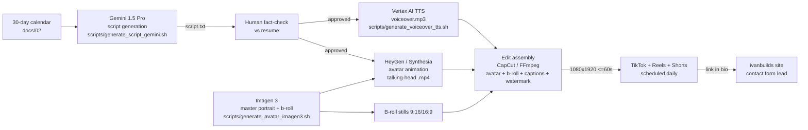

# 04 — Content Generation Pipeline (Vertex AI + HeyGen)

> Phase 3 deliverable — the full technical workflow: Gemini 1.5 Pro (scripts) → Vertex AI TTS (voiceover)
> → Imagen 3 (persona stills) → HeyGen/Synthesia (lip-synced avatar) → assembly → posting.
> Runnable helper scripts live in `scripts/` (read the headers — each needs env vars set once).

---

## 0. Pipeline overview



## 1. One-time setup (env vars)

```bash
cp scripts/.env.pipeline.example scripts/.env.pipeline   # then fill in:
export GCP_PROJECT_ID="your-gcp-project"                 # Vertex AI project
export GEMINI_API_KEY="AIza..."                          # Google AI Studio key (aistudio.google.com)
# For Vertex calls, authenticate once:
gcloud auth application-default login
gcloud config set project $GCP_PROJECT_ID
# Enable APIs:
gcloud services enable aiplatform.googleapis.com texttospeech.googleapis.com
```

---

## 2. Step B — Script generation with Gemini 1.5 Pro

**Endpoint (Vertex AI):** `gemini-1.5-pro` (or `gemini-1.5-flash-002` for drafts) via
`https://generativelanguage.googleapis.com/v1beta/models/gemini-1.5-pro:generateContent` with an AI Studio key (simplest), or the Vertex AI publisher endpoint with `gcloud auth print-access-token`.

**Reusable system prompt** (embeds persona voice + the résumé fact base + the 5-beat structure):

```text
You are the head writer for "IvanBuilds", a hyper-realistic AI tech influencer
channel (30–60s vertical videos for TikTok, Reels, Shorts).

VOICE: authoritative, highly technical yet accessible, results-oriented. Lead
with a résumé metric or concrete pain. No greetings, no filler, no hype words.

STRUCTURE (strict, ≤60s spoken):
1. HOOK (0–3s) — one line, a number or a pain.
2. PROBLEM (3–12s) — why it costs the viewer money/time.
3. SOLUTION (12–35s) — the exact technology/pattern, named explicitly.
4. PROOF (35–50s) — a real result from the fact base below, with its metric.
5. CTA (50–60s) — "Full case study on my site — link in bio." or "Follow".

FACT BASE (only these claims are allowed; never invent metrics):
- Ivan Yeo, Senior Consultant Developer, Singapore, 5+ yrs experience.
- NTUC NE Digital (Oct 2021–May 2025), Senior Dev & acting team lead, order
  management: Transport Management System replacement (XML diagrams, ERDs,
  state mappings); PostgresDB via Terraform; resilient Golang microservices
  with Subscription & Chain of Responsibility patterns; high-concurrency Email
  Automation System on GCP Cloud Run — 80% efficiency gain in manual SAP
  order posting via Cloud Scheduler; Python Locust load testing; race
  conditions resolved; React frontend modernized.
- Happy Hour Games (May 2025–Jun 2026), FullStack Dev: enterprise portal from
  scratch — React/TypeScript frontend + Golang backend; AWS S3, EC2,
  CloudFront, DynamoDB, RDS, API Gateway, CloudWatch; server-side concurrency
  optimizations; CI/CD; "Hexaplus/TravelSort" mobile game (TypeScript, Cocos
  Creator: physics, UI integration, mobile deployment).
- Shopee (May 2020–Oct 2021), QA Engineer: automation framework with Builder
  pattern + mock servers — eliminated 60% of manual test cycles; Kafka/HBase
  data pipeline testing; led a team of three.
- EP One (2021), Backend Dev (contract): helper–employer matching platform;
  React/Firebase; Golang DB migration automation — 100% data integrity.
- Infineon (2019–2020), Line Engineer Intern: Python digital twin of wafer
  testing line; bottleneck analysis with VBA, Tableau, NPL/constraint
  programming.
- Open source: WC2OpenAPI (Go middleware: AI webchat → OpenAI-compatible API),
  EasyAnalytics (Java CLI natural-language SQL assistant with schema-aware
  prompting + caching), AEO Optim (A/GEO analysis tool).
- Pioneers AI-augmented workflows & intelligent automation to optimize
  engineering velocity.

OUTPUT FORMAT per script:
- "VO:" full voiceover script with timecodes every ~5s
- "ONSCREEN:" caption text per beat (short, punchy)
- "VISUAL:" b-roll/avatar direction per beat
- "FACTCHECK:" the fact-base bullet(s) every claim maps to
```

**Call it per topic** (topic = one row of the 30-day calendar):

```bash
./scripts/generate_script_gemini.sh \
  "Manual SAP order posting was eating a team's day — how we automated 80% with Cloud Run"
```

Or raw curl:

```bash
curl "https://generativelanguage.googleapis.com/v1beta/models/gemini-1.5-pro:generateContent?key=$GEMINI_API_KEY" \
  -H 'Content-Type: application/json' \
  -X POST \
  -d '{
    "systemInstruction": { "parts": [{ "text": "<SYSTEM PROMPT ABOVE>" }] },
    "contents": [{ "parts": [{ "text": "Write script for Day 7: <topic>. Pillar D case study. 55 seconds." }] }],
    "generationConfig": { "temperature": 0.8, "maxOutputTokens": 1024 }
  }'
```

> **Human review is mandatory before production:** confirm every number appears in the FACT BASE (Phase 4 requirement).

## 3. Step A — Voiceover with Vertex AI TTS

Recommended voice for the persona: **`en-US-Neural2-J`** (clear male, confident; use `speakingRate: 1.05`). Alternative long-form voices: `en-US-Studio-O` (deeper male) if available in your region.

```bash
./scripts/generate_voiceover_tts.sh \
  output/voiceovers/day07.mp3 \
  "Manual SAP order posting was eating an entire team's day. So we automated 80 percent of it."
```

Or raw curl:

```bash
curl -X POST \
  -H "Authorization: Bearer $(gcloud auth print-access-token)" \
  -H "Content-Type: application/json" \
  -d "{
    \"input\": { \"text\": \"<VO SCRIPT>\" },
    \"voice\": { \"languageCode\": \"en-US\", \"name\": \"en-US-Neural2-J\" },
    \"audioConfig\": { \"audioEncoding\": \"MP3\", \"speakingRate\": 1.05 }
  }" \
  "https://texttospeech.googleapis.com/v1/projects/$GCP_PROJECT_ID/locations/global/text:synthesize" \
  | python3 -c 'import sys,json,base64;print(base64.b64decode(json.load(sys.stdin)["audioContent"]).decode("utf-8","ignore"),end="")' > day07.mp3
```

> The helper script handles the base64 decode cleanly (binary-safe).

## 4. Step B — Persona visuals with Imagen 3

### 4.1 Master portrait (once) → becomes HeyGen photo avatar + site image

```bash
./scripts/generate_avatar_imagen3.sh \
  output/imagen/avatar.png \
  "Photorealistic portrait of a Singaporean-Chinese male tech consultant in his early 30s, ..." # full master prompt from docs/01 §2.1
# Params inside the script: model=imagen-3.0-generate-002, aspectRatio=4:5, seed=20260101, negativePrompt as in docs/01 §2.2
```

Copy the chosen candidate to `public/images/avatar.png` (site hero picks it up automatically; the SVG placeholder is the on-error fallback).

### 4.2 Scene variations (identity-preserving)

Use the **image editing** model with the master portrait as the reference input — see the second mode in the script:

```bash
./scripts/generate_avatar_imagen3.sh \
  output/imagen/whiteboard.png \
  "Same person, now standing at a whiteboard drawing a Golang microservices architecture diagram" \
  output/imagen/avatar.png
```

### 4.3 B-roll stills

9:16 and 16:9 Imagen 3 generations for the 🎞 beats (server room dolly shot, code on monitors, Singapore skyline, hands at keyboard). Add the negative prompt; keep lighting "cool teal rim light" for brand consistency.

## 5. Step C — Avatar animation (HeyGen or Synthesia)

If lip-synced talking-head videos are desired, animate the Imagen 3 master portrait:

### 5.1 HeyGen v2 API (photo avatar + audio → talking video)

```bash
# 1) create talking photo (upload output/imagen/avatar.png once)
curl -X POST "https://api.heygen.com/v2/photo_avatar" \
  -H "X-Api-Key: $HEYGEN_API_KEY" -H "Content-Type: application/json" \
  -d '{"image_url": "https://<your-hosted>/avatar.png", "name": "IvanBuilds"}'

# 2) render video with the TTS audio from step A
curl -X POST "https://api.heygen.com/v2/video/generate" \
  -H "X-Api-Key: $HEYGEN_API_KEY" -H "Content-Type: application/json" \
  -d '{
    "video_inputs": [{
      "character": { "type": "photo_avatar", "photo_avatar_id": "<photo_avatar_id>" },
      "voice":     { "type": "audio", "audio_url": "https://<your-hosted>/day07.mp3" },
      "background": { "type": "color", "value": "#020617" }
    }],
    "dimension": { "width": 1080, "height": 1920 }
  }'
# 3) poll
curl -H "X-Api-Key: $HEYGEN_API_KEY" "https://api.heygen.com/v1/video_status.get?video_id=<id>"
```

### 5.2 Synthesia (alternative)

```json
POST https://api.synthesia.io/v2/videos
Authorization: Bearer $SYNTHESIA_API_KEY
{
  "title": "IvanBuilds Day 07 — SAP automation",
  "test": false,
  "visibility": "private",
  "aspectRatio": "9:16",
  "voiceovers": [{ "voiceId": "en-US-Neural2-J" }],
  "avatar": { "custom": { "image": { "url": "https://<your-hosted>/avatar.png" } } },
  "scenes": [{ "text": "<VO SCRIPT>", "background": "#020617" }]
}
```

> Audio-video alignment: if the avatar service generates its own TTS (Synthesia), skip step A for that render — feed the script text directly and keep the same voiceId profile.

## 6. Assembly & QA (per video)

**Assembly (CapCut or FFmpeg):**

```bash
# Simple FFmpeg composite: avatar video + TTS VO + b-roll beats
ffmpeg -i avatar_talking.mp4 -i voiceover.mp3 \
  -map 0:v -map 1:a -c:v libx264 -pix_fmt yuv420p -r 30 -s 1080x1920 \
  -shortest day07.mp4
```

- Captions: CapCut auto-captions (or `whisper` → `.srt` → burn-in with ffmpeg `subtitles=` filter).
- Watermark: bottom-left "AI presenter" PNG overlay (`overlay=40:H-200`).
- Outro: brand card 2 s (cyan→violet, "link in bio").

**QA checklist before posting (every video):**
- [ ] Every metric/claim traced to the résumé (FACTCHECK section present)
- [ ] ≤60 s total, hook lands ≤3 s, captions burned in
- [ ] "AI presenter" badge visible throughout
- [ ] 1080×1920, ≤287 MB, no platform watermark (export native, don't re-download from TikTok)
- [ ] Link in bio points at the live GitHub Pages site
- [ ] Platform AI-content label enabled

## 7. Site contact loop (closes the funnel)

Videos → "link in bio" → GitHub Pages site → `ContactForm.vue` → EmailJS/Formspree → Ivan's inbox. After any posting session, verify the funnel once end-to-end: submit a test inquiry from the live site and confirm receipt (see README §Contact form setup — step 5).
