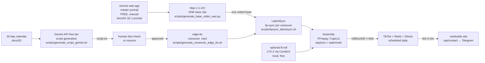

# 04 — Content Generation Pipeline (free open-source stack)

> Phase 3 deliverable — the full technical workflow, rebuilt to run at **$0 in subscriptions**:
> Gemini (scripts, free AI Studio key) → edge-tts (voiceover) → Gemini web app (master portrait)
> → **Wan 2.1-I2V** (one base talking-head clip) → **LatentSync** (lip-sync per voiceover)
> → assembly → posting. The only paid step, if you don't own a CUDA GPU, is renting one at
> cents-per-video. Runnable helpers live in `scripts/`.

---

## 0. Pipeline overview



**Cost table (the whole point of this stack):**

| Step | Tool | Cost |
|---|---|---|
| Video scripts | Gemini API (AI Studio free tier) or web app | $0 |
| Voiceover | edge-tts (Microsoft neural voices, pip) | $0 |
| Master portrait | Gemini web app (conversational, iterate free) | $0 |
| Base clip | Wan 2.1-I2V 1.3B (diffusers) | $0 local (M-series: slow) or Kaggle T4 free |
| Lip-sync | LatentSync (open source, ByteDance) | CUDA required: Kaggle T4 free, or rented 4090 ≈ **$0.02–0.05/video** |
| B-roll (optional) | LTX-2 in ComfyUI (local) | $0 |
| Assembly | FFmpeg / CapCut | $0 |

Identity-preservation principle: **the master portrait is generated once, the base clip is generated once, and only the mouth ever changes** (per voiceover, by LatentSync). No re-rolling faces per video.

## 1. One-time setup

```bash
# Voiceover (free, no key)
pip install edge-tts

# Base video generation (free; GPU strongly preferred)
pip install torch diffusers transformers accelerate safetensors

# Optional: scripted script-generation via Gemini API
cp scripts/.env.pipeline.example scripts/.env.pipeline   # fill GEMINI_API_KEY (aistudio.google.com → Get API key — free)
# LatentSync: cloned automatically on first run by scripts/lipsync_latentsync.sh
#             into ~/tools/LatentSync (override with LATENTSYNC_DIR)
# ffmpeg is needed for assembly: brew install ffmpeg
```

No GCP billing, no Vertex, no HeyGen/Synthesia accounts.

## 2. Script generation (Gemini)

Unchanged from the previous version — the system prompt (persona voice + résumé FACT BASE + 5-beat structure) lives in `docs/03_VIDEO_SCRIPTS.md` and `scripts/generate_script_gemini.sh`.

```bash
./scripts/generate_script_gemini.sh \
  "Manual SAP order posting was eating a team's day — how we automated 80% with Cloud Run"
```

> **Human review is mandatory before production:** confirm every number appears in the FACT BASE (Phase 4 requirement). No invented metrics — ever.

## 3. Voiceover (edge-tts — free neural voices)

```bash
./scripts/generate_voiceover_edge_tts.sh \
  output/voiceovers/day07.mp3 \
  "Manual SAP order posting was eating an entire team's day. So we automated 80 percent of it."
```

Persona voice: **`en-US-AndrewNeural`** (confident, warm) at rate `+10%`. Alternatives: `en-US-GuyNeural` (news-anchor energy), `en-US-ChristopherNeural` (calmer/deeper). Override via `TTS_VOICE` / `TTS_RATE` env vars. No API key, no billing.

## 4. Master portrait (once) — Gemini web app

1. Open [gemini.google.com](https://gemini.google.com) and paste the **master prompt** from `docs/01_AI_PERSONA.md §2.1` (with the §2.2 negative prompt as "avoid:").
2. Iterate conversationally ("more candid", "shirt collar visible", "cooler rim light") until satisfied — free, no quota anxiety.
3. Download → save as **`public/images/avatar.png`** → commit & push (hero + OG image pick it up; SVG placeholder is the fallback).
4. **Scene variations:** attach the master portrait back into the chat as a reference and describe the new scene ("same person, at a whiteboard drawing a Golang microservices diagram"). Gemini keeps the face — this replaces the old Imagen 3 reference-image flow.

> Optional scripted alternative (needs GCP billing): `scripts/generate_avatar_imagen3.sh` — same prompts, Vertex AI `imagen-3.0-generate-002`, fixed seed. Only worth it for batch generation; the manual path above is free.

## 5. Base talking-head clip (once) — Wan 2.1-I2V

The **one generated video that defines the persona forever**. Generate from the master portrait (I2V, not T2V — T2V invents a new face):

```bash
python3 scripts/generate_base_video_wan.py \
  --portrait public/images/avatar.png \
  --output output/wan/base.mp4
```

Rules baked into the script (see its header for the why):
- **I2V from the master portrait** — identity carry
- **Subtle motion, neutral resting mouth** — LatentSync repaints the mouth region; a clean, still canvas means invisible seams. Do NOT prompt for "talking".
- 480×832 (9:16), 16 fps, fixed seed
- **Hardware:** CUDA ≈ 2–5 min (81 frames). Apple Silicon MPS works in fp16 but is slow (the script defaults to 33 frames there). The clip gets boomerang-looped to the voiceover length in step 6, so even a short base is fine.

**Quality gate (manual, once):** watch the clip — face matches the portrait? mouth neutral? motion subtle? no artifacts? **Only proceed when this clip is good — every video you post will be this face.**

## 6. Per-video lip-sync — LatentSync (one base, many re-syncs)

For every video: take the SAME base clip + the new voiceover → LatentSync repaints the mouth to match the phonemes. Face, lighting, persona stay frozen; marginal cost ≈ $0.

```bash
./scripts/lipsync_latentsync.sh output/wan/base.mp4 output/voiceovers/day07.mp3 output/latentsync/day07.mp4
```

The script: boomerang-loops the base to the voiceover's exact duration (no jump cuts), runs LatentSync inference, saves the result.

**Hardware reality:** LatentSync is CUDA-first. Options:
- **Kaggle notebook, T4 GPU** — 30 GPU-hours/week free; upload base + audio, run the script
- **Rented 4090** (RunPod/Vast.ai ~$0.30–0.50/hr) — a 60s clip takes ~5–10 min → **cents per video**
- MuseTalk is the fallback (faster/realtime, softer quality) — LatentSync's diffusion mouth is the better pick for close-ups

**Quality gate (video #1, human eyes):** if the mouth looks uncanny in close-up, **fall back to the B-roll format** (§7) — the 30-day calendar works without a talking head, and an obviously-fake mouth costs the brand more than no face at all.

## 7. Assembly & QA (per video)

**Assembly (CapCut or FFmpeg):**

```bash
# Combine talking-head + voiceover + captions; upscale to platform spec
ffmpeg -i output/latentsync/day07.mp4 -i output/voiceovers/day07.mp3 \
  -map 0:v -map 1:a -c:v libx264 -pix_fmt yuv420p -r 30 -s 1080x1920 \
  -shortest output/final/day07.mp4
```

- Captions: CapCut auto-captions (or `whisper` → `.srt` → ffmpeg `subtitles=` burn-in)
- Watermark: bottom-left "AI presenter" PNG overlay (`overlay=40:H-200`)
- Outro: brand card 2s (cyan→violet, "link in bio")
- Optional B-roll: generate 5s clips with **LTX-2 in ComfyUI** (local, free — runs well on Apple Silicon) for the between-beat visuals (server rooms, cloud panning shots, code-on-monitors)

**QA checklist before posting (every video):**
- [ ] Every metric/claim traced to the résumé (FACTCHECK section present)
- [ ] ≤60 s total, hook lands ≤3 s, captions burned in
- [ ] "AI presenter" badge visible throughout
- [ ] 1080×1920, ≤287 MB, no platform watermark (export native, don't re-download from TikTok)
- [ ] Link in bio points at the live site (`ivanbuilds.ivangemini930.workers.dev` or custom domain)
- [ ] Platform AI-content label enabled

## 8. Site contact loop (closes the funnel)

Videos → "link in bio" → site → `ContactForm.vue` → `/api/contact` (Cloudflare Worker) → Telegram ping on Ivan's phone. After any posting session, verify the funnel once end-to-end: submit a test inquiry from the live site and confirm the Telegram message arrives (README §Contact form routing — Test the integration).
